# Folia Files

**A native file manager for Mac, for people who outgrew the Finder.**

[Website](https://foliafiles.com/?ref=github) · [Download the 7-day free trial](https://foliafiles.com/en/download/?ref=github) · [Features](https://foliafiles.com/en/features/?ref=github) · [The film (1:24)](https://youtu.be/ub2iXtMlC-Y) · [Press kit](https://foliafiles.com/en/press/?ref=github) · [Discussions](https://github.com/Foliafiles/folia-files/discussions)

This repository is the public home of Folia Files on GitHub: **ideas you can vote on, questions, announcements, bug reports and themes shared by users.** The app itself is closed source.

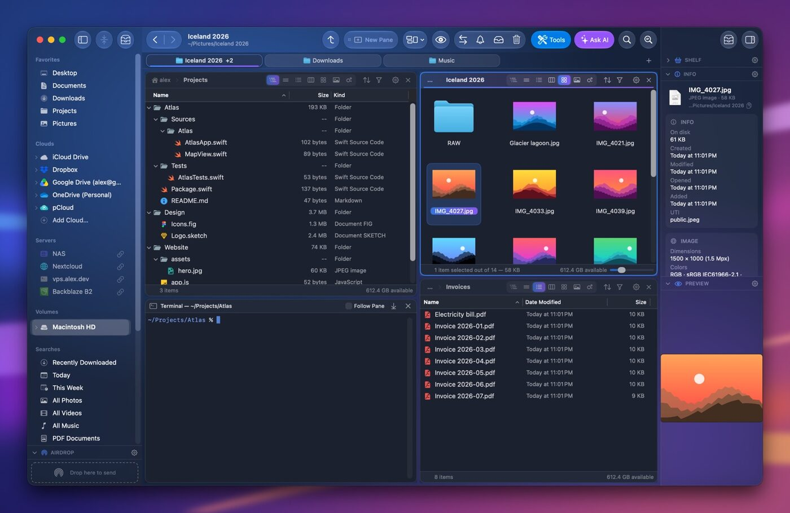

## See it in action

A 33-second tour:

https://github.com/user-attachments/assets/57fef345-8f7a-464e-bfde-4bbaede22af4

<a href="https://youtu.be/ub2iXtMlC-Y">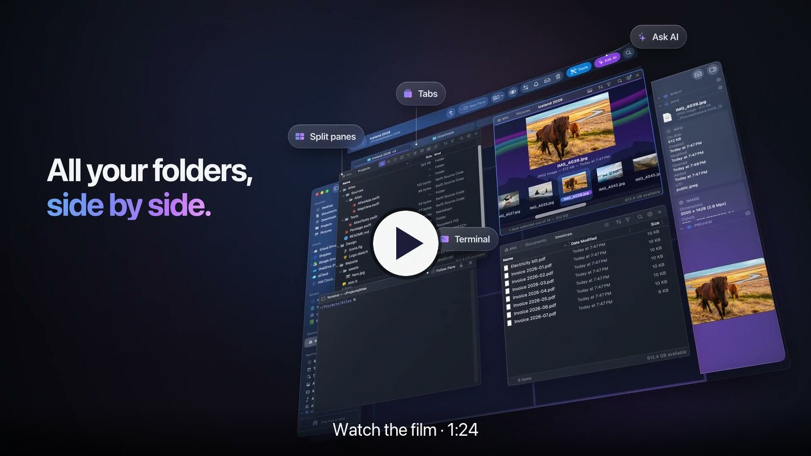</a>

## What it is

- As many panes side by side as you need, each with its own view (icons, list, detailed list, tree, columns, gallery, mosaic, branches, board, disk space), saved as scenes
- Search by name, by the text inside documents and screenshots, or by what your photos show
- SMB, WebDAV, AFP, NFS, FTP, SFTP and S3 servers and more than 50 cloud services mounted like disks (rclone comes inside the app)
- Every copy, move and rename in a history you can undo
- A clipboard history (⌃⌥V), a drawer at the edge of the screen and an assistant next to every app's Open and Save dialogs
- A text editor, batch rename, duplicates, PDF tools, sync, backups and Mac care

Native app (Swift, AppKit, SwiftUI), macOS 14 or later, universal (Apple silicon and Intel), in 8 languages. One-time purchase: $49.99 (49,99 € in the euro area) for up to 3 Macs, or $69.99 (69,99 €) for 6, every update included, no subscription, no account, 7-day free trial. Every feature is explained in the [documentation](https://foliafiles.com/en/docs/?ref=github).

## Screenshots

<table>
<tr>
<td width="50%">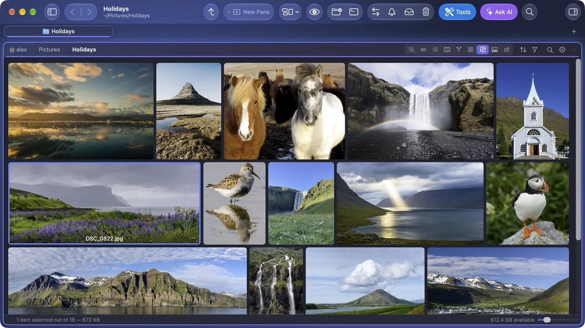 <b>Mosaic</b>: every photo whole, at its own shape.</td>
<td width="50%">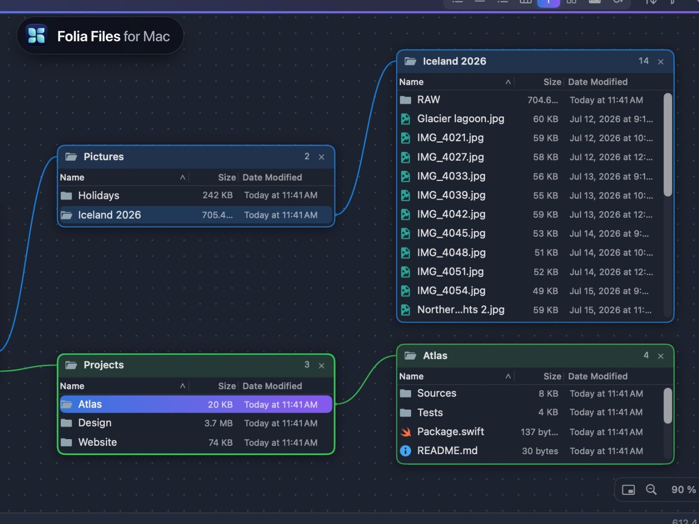 <b>Branches</b>: your folders as a map, one card per folder.</td>
</tr>
<tr>
<td>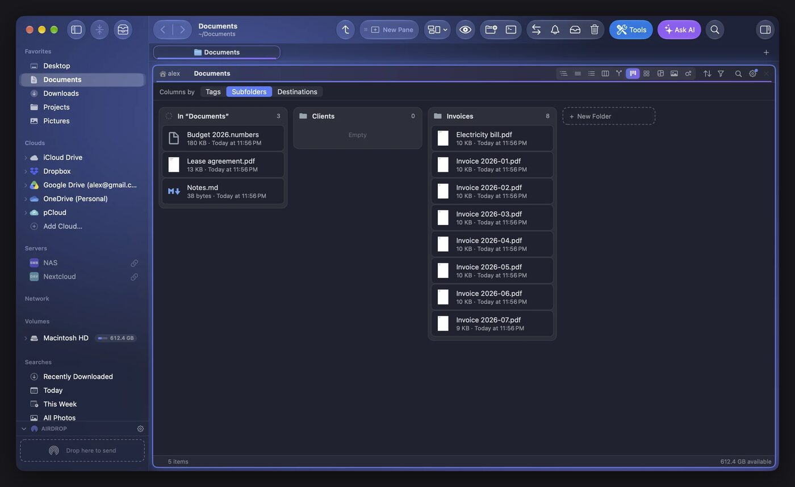 <b>Board</b>: drag a file to another column to move or tag it.</td>
<td>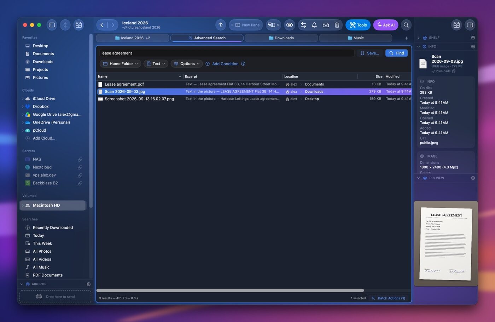 <b>Search</b> by name, inside documents and screenshots, or by what a photo shows.</td>
</tr>
<tr>
<td>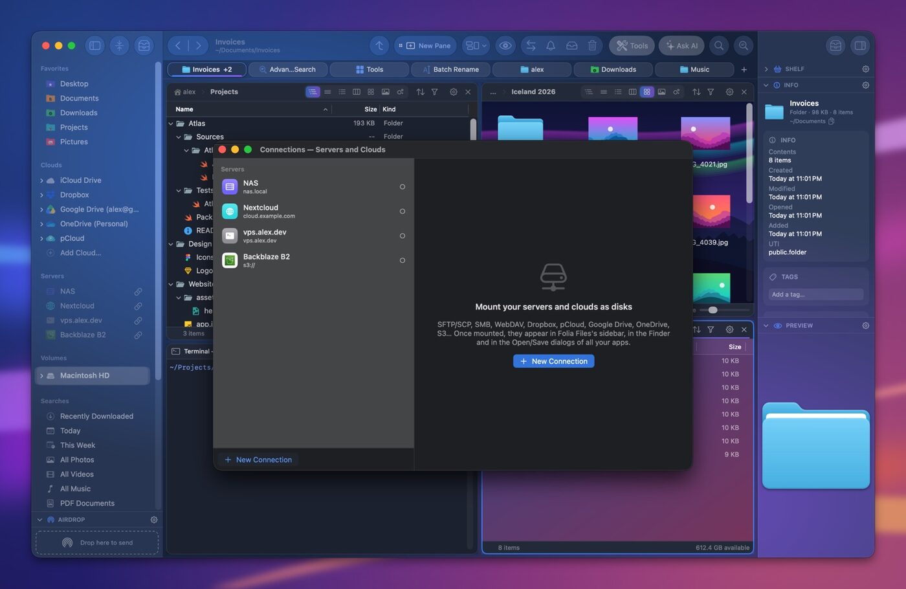 <b>Servers and clouds</b> mounted like disks: SFTP, SMB, FTP, S3, and more than 50 cloud services.</td>
<td>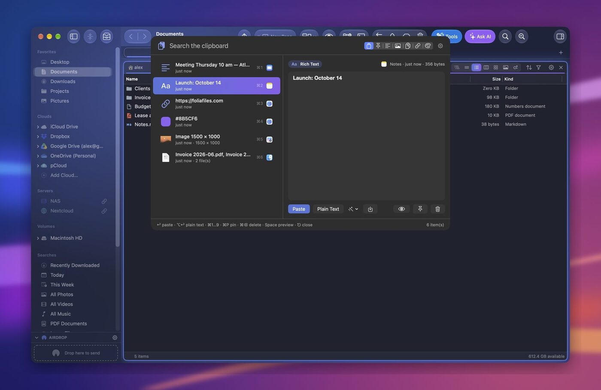 <b>Clipboard history</b> (⌃⌥V): everything you copied, pinned or searched.</td>
</tr>
<tr>
<td>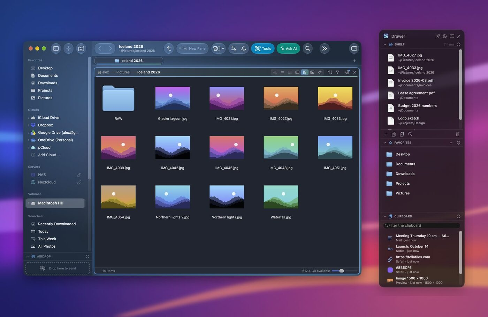 <b>The drawer</b>: drop files at the edge of the screen, keep them at hand from any app.</td>
<td>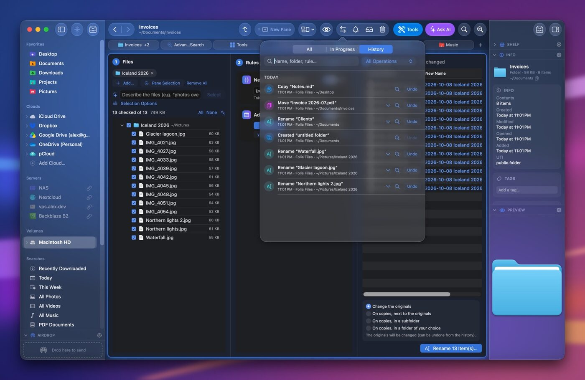 <b>Copies, moves and renames can be undone</b>, even days later, from their history.</td>
</tr>
<tr>
<td>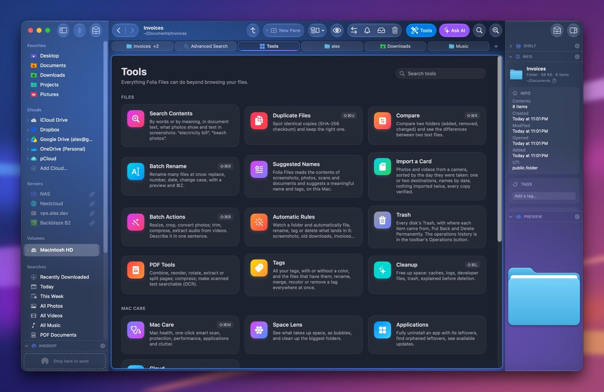 <b>Built-in tools</b>: batch rename, duplicates, compare folders, PDF tools, sync, backups, Mac care.</td>
<td>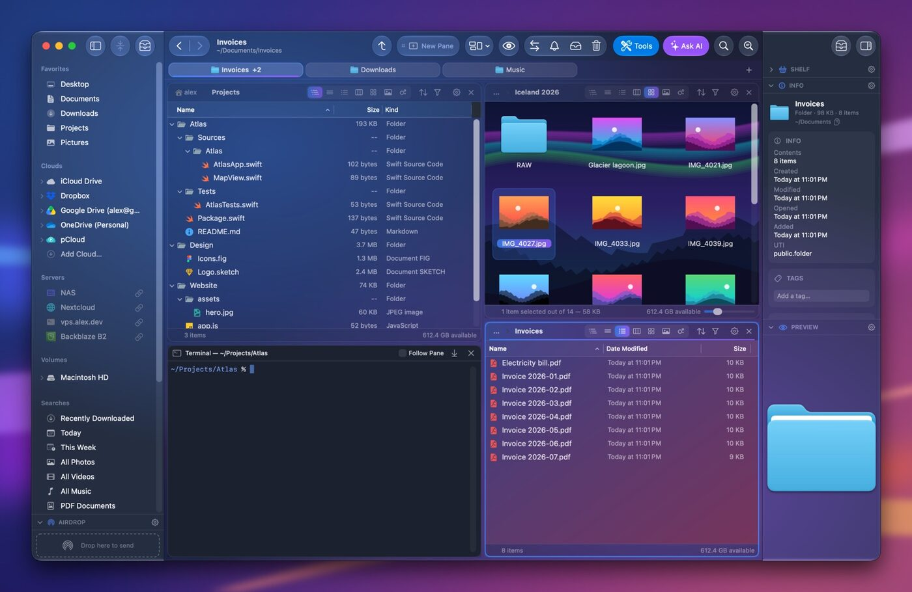 <b>Themes</b>, from quiet to see-through glass.</td>
</tr>
</table>

## Video tutorials

Short tutorials, each showing one thing in the real app ([all of them on YouTube](https://www.youtube.com/@foliafiles/videos), and on the [website](https://foliafiles.com/en/tutorials/?ref=github)):

- [Two folders side by side](https://youtu.be/lF6tM1o2tT8) (0:53)
- [The Mosaic view: every photo at its own shape](https://youtu.be/5JH8s6Ax_20) (1:11)
- [See your folders as a map](https://youtu.be/JMsbHnEGkF4) (1:07)
- [Save a layout of panes as a scene](https://youtu.be/TjFz8WPjkvs) (1:05)
- [Every module, one by one](https://youtu.be/qzVxFImbPZo) (2:56)
- [Search by name, inside files, or by what's in a photo](https://youtu.be/0NeroI07QoQ) (0:55)
- [Clipboard history on a Mac](https://youtu.be/vO6pSnjMthI) (0:35)
- [Undo a file move, copy or rename](https://youtu.be/HEQ4rA5pH_c) (0:38)
- [Rename photos by the date they were taken](https://youtu.be/RQ5hMU37pcE) (0:46)
- [Compare two folders](https://youtu.be/o3on1qVyDKI) (0:37)
- [Convert, resize and clean up photos from the right-click menu](https://youtu.be/zJoWEOMEWJM) (1:06)
- [Themes and a see-through window on Mac](https://youtu.be/uqncj8pH5Ts) (1:16)

## Ideas, questions and news

[GitHub Discussions](https://github.com/Foliafiles/folia-files/discussions) is the place to talk about Folia Files:

- **[Ideas](https://github.com/Foliafiles/folia-files/discussions/categories/ideas)**: suggest a feature, or upvote one that's already there. The most wanted ones go first.
- **[Q&A](https://github.com/Foliafiles/folia-files/discussions/categories/q-a)**: ask how to do something; other users and we answer.
- **[Announcements](https://github.com/Foliafiles/folia-files/discussions/categories/announcements)**: new versions and what's in them.

## Report a bug

[Open an issue](../../issues/new/choose).

Please **never post a license key or personal files** here: for anything about a purchase or a license, write to support@foliafiles.com.

## Themes

Folia Files comes with a gallery of 21 themes, one click away in Settings › Themes › Gallery, and [shown on the website](https://foliafiles.com/en/themes/?ref=github):

| Theme | |
|---|---|
| Northern Lights | Greens and blues rippling behind your folders. |
| Coral | Warm and bright, like a summer evening by the sea. |
| Sakura | Soft pink, rounded corners and plenty of room. |
| Matcha | A calming sage green, nothing loud. |
| Terracotta | Earthy ochres and reds, warm yet understated. |
| Sand | Soft beige with alternating rows: easy on the eyes for hours. |
| Neon | Electric magenta and cyan, for late-night work. |
| Fjord | Icy blues and slate greys, calm and crisp. |
| Sunshine | Sunny yellow and orange, for days full of energy. |
| Deep Sea | Deep blue, all the way into the sidebar. |
| Burgundy | A deep, elegant red for a hushed workspace. |
| Paper | Warm grey, fine lines, no distractions. |
| Ink | Dark, dense indigo: lots of files on screen. |
| Pastel | Lilac and powder pink, gentle all over. |
| Copper | Copper glints and a matching terminal, for developers. |
| Lagoon | Turquoise and sea green, fresh as a swim. |
| Storm | Storm grey streaked with electric violet. |
| Plum | Rich, deep purples, from backdrop to selection. |
| Prism | Every colour at once, behind a sober window. |
| Phosphor | Phosphor green and sharp corners, like an old terminal. |
| Classic Blue | The deep blue of the file managers of old, with a turquoise selection. |

### Share your own theme

1. In Folia Files: Settings › Themes, select your theme, then **Export…** (a `.json` file).
2. Open a pull request that adds it to [`community/`](community/) with a screenshot (light and dark if you can), or attach both to an issue.
3. Others import it with Settings › Themes › **Import…**. The nicest ones may join the built-in gallery.

Shared themes are under [CC0 1.0](community/LICENSE) (public domain).

---

Made by [Wonderlink SL](https://foliafiles.com/en/about/?ref=github), Spain · support@foliafiles.com · [YouTube](https://www.youtube.com/@foliafiles)
